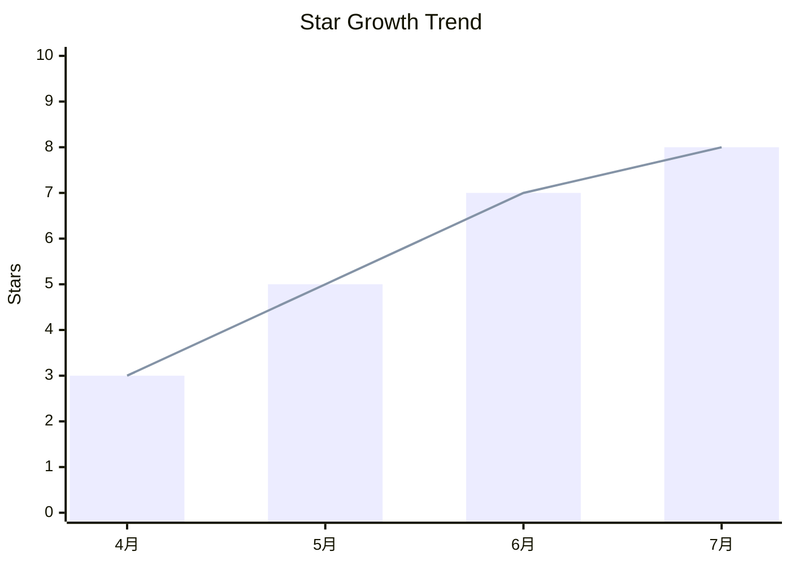
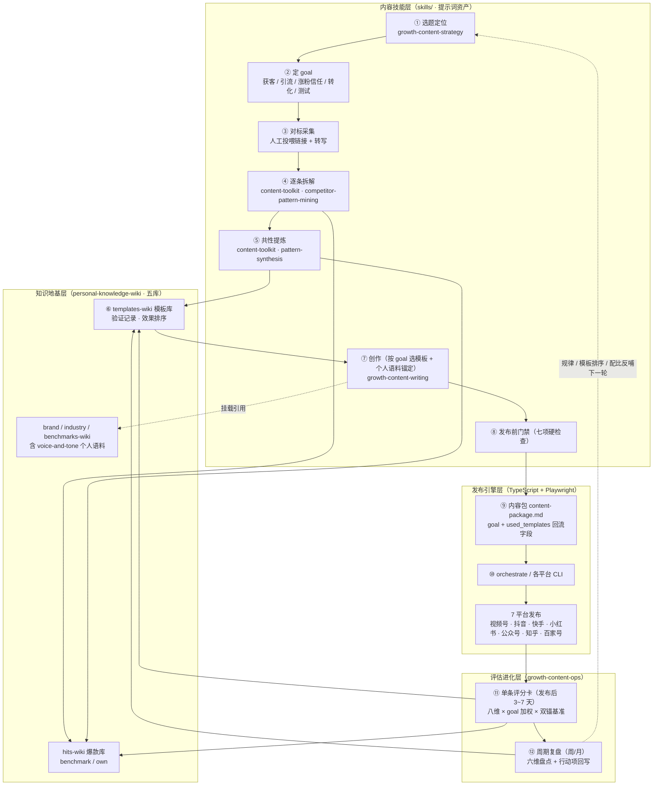

<div align="center">

# social-publish-skills

**一站式社媒内容生产与发布工具集 · 从选题到分发，全链路 Agent 化**

[](https://github.com/puppyfront-web/social-publish-skills/stargazers)
[](https://github.com/puppyfront-web/social-publish-skills/network/members)
[](LICENSE)
[](https://nodejs.org)
[](#环境要求)

**覆盖 7 大主流平台 · 13 个可复用 Skill · 支持 Codex / Claude Code / OpenClaw**

</div>

---

## ⭐ Star 增长曲线



> 自 2026 年 4 月开源以来持续增长，感谢每一位 Star 支持 🙏

---

## 📖 目录

- [这是什么](#-这是什么)
- [整体架构与流程](#-整体架构与流程)
- [平台支持](#-平台支持)
- [Skill 能力矩阵](#-skill-能力矩阵)
- [快速开始](#-快速开始)
- [在 Agent 中接入](#-在-agent-中接入)
- [使用流程](#-使用流程)
- [常用命令与参数](#-常用命令与参数)
- [数据与配置](#-数据与配置)
- [开发调试](#-开发调试)
- [联系与反馈](#-联系与反馈)

---

## 🎯 这是什么

`social-publish-skills` 是一个基于 **TypeScript + Playwright** 的社媒内容生产与发布工具集。它把两件事打包成 Agent 可调用的 Skill：

1. **内容生产**（新增）— 从选题、文案创作到发布运营的全流程提示词资产
2. **平台发布**（核心）— 在本机完成扫码登录、登录态校验、内容发布（短视频 + 图文）

设计理念：**让 Agent 既能"写"，也能"发"**。一份内容，多平台分发，全链路自动化。

### 适合什么场景

- ✅ 首次登录某个平台账号
- ✅ 检查本机已有 cookie 是否仍然可用
- ✅ 将一个视频发布到单个或多个平台
- ✅ 自动将 Markdown / GitHub / 网页文章格式化后发布到公众号、知乎、百家号
- ✅ 让 Agent 帮你从 0 到 1 创作爆款内容（选题→标题→正文→优化）
- ✅ 拆解单条爆款视频/文案的可复用结构，抽象成创作模板
- ✅ 建立个人/品牌 LLM 知识库（Karpathy LLM wiki 范式），让创作引用私有资料
- ✅ 在自动化工作流中编排"创作 → 审核 → 发布"全链路

---

## 🧭 整体架构与流程

一句话架构：**三层体系**——内容技能层（选题→拆解→提炼→创作→优化）、知识地基层（五库 LLM wiki）、发布引擎层（7 平台 CLI），以「**内容目标 goal**」和「**内容包**」为两个交接契约，形成从选题到数据回流的**自我进化闭环**。

### 端到端流程架构图



### 十二步闭环速查

| 步骤 | 动作 | 用什么 | 产出落在哪 |
| --- | --- | --- | --- |
| ① 选题定位 | 定位链路 + 选题校验四问 | `growth-content-strategy` | 选题卡 |
| ② 定 goal | 获客 / 引流 / 涨粉信任 / 转化 / 测试，决定后续所有口径 | `growth-content-writing` 前置问 | 选题卡 |
| ③ 对标采集 | 投喂对标爆款链接 + 转写文本 | 人工投喂（CLI `collect` 规划中） | wiki `inbox/` |
| ④ 逐条拆解 | 结构公式 / 语言模式 / 情绪曲线 / CTA 五层逆向 | `content-toolkit/competitor-pattern-mining` | `hits-wiki/benchmark/` |
| ⑤ 共性提炼 | 数据侧分布 + 文本侧聚类，**按 goal 分区** | `content-toolkit/pattern-synthesis` | 共性规律 + 模板候选 |
| ⑥ 模板入库 | 按模板页 Schema 建条目（带验证记录字段） | `templates-wiki` Schema | `templates-wiki/` |
| ⑦ 创作 | 按 goal 选已验证模板 + 平台调性变体 + 个人语料锚定 | `growth-content-writing` + `voice-and-tone` | 创作终稿 |
| ⑧ 发布前门禁 | 七项硬检查（goal/CTA、钩子、标题封面、调性、去 AI 味 12 信号、合规、素材），不过不发布 | `growth-content-writing` 发布前门禁 | 通过 / 打回 |
| ⑨ 内容包 | frontmatter 含 `goal` / `used_templates` 回流字段 | `content-package.md` 契约 | `content-<主题>.md` |
| ⑩ 发布 | 内容包转 `tasks[]` 或单平台 CLI 参数 | `orchestrate` / 各平台 CLI | 平台作品 |
| ⑪ 单条评分卡 | 发布后 3~7 天，八维 × goal 加权 × 双锚基准，短板归因指认环节 | `growth-content-ops/retrospective-scorecard` | `hits-wiki/own/` + 模板 verdicts |
| ⑫ 周期复盘 | 周/月六维盘点（健康度/爆文率/配比/画像命中/模板战况/规律抽查）+ 三行结论 + 行动项回写 | `growth-content-ops/periodic-review` | 选题卡 / 模板页 / 规律区 |

> 闭环的关键在 ⑫ → ①：数据回流后，共性规律更新选题判断、模板按真实表现排序淘汰（连续 2 次低于常态即淘汰）、目标内容配比按数据调整——下一轮创作只套用被验证过的赢家，这是本仓库"自我进化"能力的来源。去 AI 味体系（12 信号诊断 + 事实零编造红线 + 个人语料锚定）横切在 ⑦⑧ 两步。详细路由见 [`skills/content-routing.md`](skills/content-routing.md)。

---

## 🌐 平台支持

| 平台 | 标识 | 视频 | 图文 | 状态 |
| --- | --- | :---: | :---: | --- |
| 微信视频号 | `tencent` | ✅ | — | 稳定 |
| 抖音 | `douyin` | ✅ | — | 稳定 |
| 快手 | `kuaishou` | ✅ | — | 稳定 |
| 小红书 | `xiaohongshu` | ✅ | ✅ | 稳定 |
| 微信公众号 | `wechatmp` | — | ✅ | 稳定 |
| 知乎 | `zhihu` | — | ✅ | 稳定 |
| 百家号 | `baijiahao` | — | ✅ | 稳定 |
| B 站 | `bilibili` | — | — | 暂不支持 |

---

## 🧩 Skill 能力矩阵

仓库中的 Skill 分两大类：**内容生产**（提示词资产，纯方法论）和**平台发布**（CLI 实现，可执行）。

### 内容生产

**增长三件套**（按获客链路分层，双向交叉路由）

> 内容技能的首次分流看总览路由 [`skills/content-routing.md`](skills/content-routing.md)（用户意图 → 技能决策树）；创作终稿到发布的交接格式看 [`skills/multi-platform-publish-orchestrator/references/content-package.md`](skills/multi-platform-publish-orchestrator/references/content-package.md)（内容包）。

| Skill | 定位 | 核心能力 | 状态 |
| --- | --- | --- | --- |
| `skills/growth-content-strategy/` | 策略层 | 选题挖掘、账号定位、对标拆解、矩阵裂变 | 可用 |
| `skills/growth-content-writing/` | 创作层 | 爆款标题、各平台正文、口播脚本、仿写改写 | 可用 |
| `skills/growth-content-ops/` | 运营层 | 文案优化、爆款拆解、评论区互动、发布时间 | 可用 |

**内容工具包 + 知识库**（单点深挖 + 横切地基）

| Skill | 定位 | 核心能力 | 状态 |
| --- | --- | --- | --- |
| `skills/content-toolkit/` | 单点工具 | 视频结构分析（钩子/铺垫/高潮/结尾）、竞品模式拆解、爆款共性提炼（pattern-synthesis）、去 AI 味改写 | 可用 |
| `skills/personal-knowledge-wiki/` | 知识地基 | LLM wiki 范式私有资料库（品牌/行业/爆款/对标/模板五类 Schema，模板带使用验证记录） | 可用 |

### 平台发布

| Skill | 类型 | CLI / 实现状态 | 状态 |
| --- | --- | --- | --- |
| `skills/tencent-upload/` | 单平台视频发布 | 已实现：`tencent check\|login\|upload` | ✅ 可用 |
| `skills/douyin-upload/` | 单平台视频发布 | 已实现：`douyin check\|login\|upload` | ✅ 可用 |
| `skills/kuaishou-upload/` | 单平台视频发布 | 已实现：`kuaishou check\|login\|upload` | ✅ 可用 |
| `skills/xiaohongshu-upload/` | 单平台图文/视频发布 | 已实现：`xiaohongshu check\|login\|upload-video\|upload-note` | ✅ 可用 |
| `skills/wechatmp-article-upload/` | 单平台图文发布 | 已实现：`wechatmp check\|login\|publish` | ✅ 可用 |
| `skills/zhihu-article-upload/` | 单平台图文发布 | 已实现：`zhihu check\|login\|publish` | ✅ 可用 |
| `skills/baijiahao-article-upload/` | 单平台图文发布 | 已实现：`baijiahao check\|login\|publish` | ✅ 可用 |
| `skills/multi-platform-publish-orchestrator/` | 多平台编排 | 已实现：`orchestrate` / `verify-scan-login` | ✅ 可用 |
| `skills/douyin-upload-prompt/` | 上传前文案补全 | 无独立 CLI，配合抖音上传使用 | 🔶 辅助可用 |
| `skills/bilibili-upload/` | 单平台视频发布 | 未实现对应 CLI 子命令 | ⛔ 占位 |

**状态说明**：`✅ 可用` = 仓库已有 `src/platforms/*.ts` 与 `node dist/cli.js` 子命令；`🔶 辅助可用` = 非发布引擎，配合已实现平台使用；`⛔ 占位` = 仅保留模板，不可执行。

---

## 🚀 快速开始

### 环境要求

- Node.js `>= 20`
- 本机可运行 Playwright Chromium

### 安装

首次使用，在仓库根目录执行：

```bash
npm install
npx playwright install chromium
npm run build
```

> 说明：仓库默认不提交 `dist/`，完成构建后才能使用 `node dist/cli.js ...`

### 三十秒上手

```bash
# 1. 登录账号（扫码在本机完成）
node dist/cli.js douyin login --account my_account

# 2. 检查登录态
node dist/cli.js douyin check --account my_account

# 3. 发布视频
node dist/cli.js douyin upload \
  --account my_account \
  --file /absolute/path/to/video.mp4 \
  --title "标题" \
  --tags "话题1,话题2"
```

---

## 🤖 在 Agent 中接入

本仓库既可手动使用，也可接入 `Codex`、`Claude Code`、`OpenClaw` 等 Agent。

### 接入原则

- 所有命令都在**仓库根目录**执行
- 首次运行先完成 `npm install` → `npx playwright install chromium` → `npm run build`
- 发布视频使用**绝对路径**
- 扫码登录必须在**用户本机**完成

### Codex

```text
先阅读 AGENTS.md，并在仓库根目录执行命令。
如果 dist/cli.js 不存在，先安装依赖、安装 chromium 并构建。
然后使用 node dist/cli.js 完成登录 / 检查 / 上传。
```

### Claude Code

```text
请先阅读 README.md 和 AGENTS.md。
所有 npm 和 node dist/cli.js 命令都在仓库根目录执行。
不要跳过登录，不要伪造 cookie，扫码步骤在本机完成。
```

### OpenClaw

将本仓库的 `skills/` 目录提供给 OpenClaw，让 Agent 按需读取对应平台的 `SKILL.md`。实际执行仍统一调用本仓库 CLI。

常见映射：

| 能力 | Skill |
| --- | --- |
| 内容创作（选题/文案/优化） | `skills/growth-content-strategy/`、`growth-content-writing/`、`growth-content-ops/` |
| 视频号发布 | `skills/tencent-upload/` |
| 抖音发布 | `skills/douyin-upload/` |
| 快手发布 | `skills/kuaishou-upload/` |
| 小红书发布 | `skills/xiaohongshu-upload/` |
| 公众号图文发布 | `skills/wechatmp-article-upload/` |
| 知乎文章发布 | `skills/zhihu-article-upload/` |
| 百家号文章发布 | `skills/baijiahao-article-upload/` |
| 多平台顺序发布 | `skills/multi-platform-publish-orchestrator/` |

更多安装和适配说明见 [INSTALL.md](INSTALL.md) 和 [AGENTS.md](AGENTS.md)。

---

## 📋 使用流程

推荐按下面顺序使用。

### 1. 登录账号

首次使用某个平台，先扫码登录：

```bash
node dist/cli.js tencent login --account my_account
node dist/cli.js douyin login --account my_account
node dist/cli.js kuaishou login --account my_account
node dist/cli.js xiaohongshu login --account my_account
node dist/cli.js wechatmp login --account my_account
node dist/cli.js zhihu login --account my_account
node dist/cli.js baijiahao login --account my_account
```

- `--account` 是你给账号起的别名
- 同一平台下，不同别名会保存为不同的 cookie 文件

### 2. 检查登录态

```bash
node dist/cli.js <platform> check --account my_account
```

### 3. 发布单个平台

#### 微信视频号

```bash
node dist/cli.js tencent upload \
  --account my_account \
  --file /absolute/path/to/video.mp4 \
  --title "标题" \
  --tags "标签1,标签2"
```

#### 抖音

```bash
node dist/cli.js douyin upload \
  --account my_account \
  --file /absolute/path/to/video.mp4 \
  --title "标题" \
  --desc "描述" \
  --tags "话题1,话题2"
```

#### 快手

```bash
node dist/cli.js kuaishou upload \
  --account my_account \
  --file /absolute/path/to/video.mp4 \
  --title "标题" \
  --desc "描述" \
  --tags "话题1,话题2"
```

#### 小红书视频

```bash
node dist/cli.js xiaohongshu upload-video \
  --account my_account \
  --file /absolute/path/to/video.mp4 \
  --title "标题" \
  --desc "描述" \
  --tags "话题1,话题2"
```

#### 小红书图文

```bash
node dist/cli.js xiaohongshu upload-note \
  --account my_account \
  --images /absolute/path/to/1.png /absolute/path/to/2.png \
  --title "标题" \
  --note "正文" \
  --tags "话题1,话题2"
```

#### 微信公众号图文

```bash
node dist/cli.js wechatmp publish \
  --account my_account \
  --source /absolute/path/to/article.md \
  --title "文章标题" \
  --author "作者名"
```

支持 GitHub / URL 来源：

```bash
# 从 GitHub 同步
node dist/cli.js wechatmp publish \
  --account my_account \
  --source https://github.com/owner/repo/blob/main/README.md \
  --source-type github \
  --title "从 GitHub 同步的文章"

# 从网页提取
node dist/cli.js wechatmp publish \
  --account my_account \
  --source https://example.com/post/123 \
  --source-type url \
  --title "从网页提取的文章"
```

#### 知乎 / 百家号文章

```bash
# 知乎（默认保存草稿，加 --publish 直接发布）
node dist/cli.js zhihu publish \
  --account my_account \
  --source /absolute/path/to/article.md \
  --title "文章标题"

# 百家号
node dist/cli.js baijiahao publish \
  --account my_account \
  --source /absolute/path/to/article.md \
  --title "文章标题"
```

### 4. 多平台顺序发布

复制并修改示例配置：

```bash
cp skills/multi-platform-publish-orchestrator/references/orchestrator.config.example.json ./orchestrator.config.json
```

然后执行：

```bash
node dist/cli.js orchestrate --config ./orchestrator.config.json
```

`orchestrate` 支持混合任务：`tencent` / `douyin` / `kuaishou` / `xiaohongshu` / `wechatmp` / `zhihu` / `baijiahao`。

---

## ⌨️ 常用命令与参数

### 命令一览

```bash
node dist/cli.js <platform> login --account <name>      # 登录
node dist/cli.js <platform> check --account <name>      # 检查登录态
node dist/cli.js <platform> upload [options]            # 发布视频
node dist/cli.js xiaohongshu upload-video|upload-note   # 小红书
node dist/cli.js wechatmp|zhihu|baijiahao publish       # 图文
node dist/cli.js orchestrate --config <config.json>     # 多平台编排
```

`<platform>` 可选：`tencent` / `douyin` / `kuaishou` / `xiaohongshu` / `wechatmp` / `zhihu` / `baijiahao`

### 常用参数

| 参数 | 说明 |
| --- | --- |
| `--account` | 账号别名 |
| `--file` | 视频绝对路径 |
| `--title` | 标题 |
| `--desc` | 描述（仅抖音、快手） |
| `--tags` | 逗号分隔标签 |
| `--schedule` | 定时发布 `YYYY-MM-DD HH:mm` |
| `--draft` | 小红书存草稿，不直接发布（仅 `upload-video` / `upload-note`） |
| `--source` | 图文来源（Markdown 路径 / GitHub URL / 网页 URL） |
| `--source-type` | `auto\|markdown\|github\|url` |
| `--publish` | 图文直接发布（默认保存草稿） |

---

## 🗂️ 数据与配置

### 数据目录

默认数据目录：

```text
~/.social-publish-skills/
```

cookie 默认保存在：

```text
~/.social-publish-skills/cookies/<platform>/<account>.json
```

### 常用环境变量

| 变量 | 说明 |
| --- | --- |
| `SOCIAL_PUBLISH_DATA_DIR` | 自定义数据目录 |
| `SOCIAL_PUBLISH_HEADLESS=0` | 使用有界面浏览器运行 |
| `SOCIAL_PUBLISH_CHROME_PATH` | 指定本机 Chrome 路径 |

---

## 🔧 开发调试

不经过构建直接运行：

```bash
npm run dev -- douyin check --account my_account
```

---

## 💬 联系与反馈

- **问题反馈**：[提交 Issue](https://github.com/puppyfront-web/social-publish-skills/issues)
- **邮箱**：[puppy.front@gmail.com](mailto:puppy.front@gmail.com)
- **欢迎贡献**：Fork → 修改 → 提交 PR

如果这个项目对你有帮助，欢迎 Star ⭐ 支持，这是持续维护的动力。

---

## 📄 许可证

[MIT](LICENSE)
